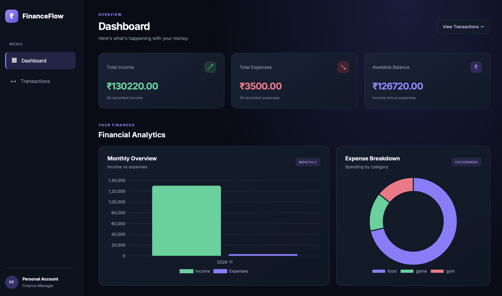

# Personal Finance & Expense Tracker

A web-based personal finance management application built using **Python, Flask, and MySQL**. FinanceFlow helps users manage income and expenses, track transactions, and understand their spending through financial summaries and visual analytics.

## Application Preview



## Features

- **Dashboard:** View total income, expenses, and available balance.
- **Transaction Management:** Add, edit, and delete income and expense records.
- **Transaction History:** View all financial transactions.
- **Search & Filtering:** Search transactions and filter by type and date range.
- **Monthly Analytics:** Visualize monthly income and expenses using charts.
- **Category-wise Analysis:** Analyze spending across different categories.
- **MySQL Integration:** Persistently store financial transaction records.

## Technology Stack

| Technology | Purpose |
|---|---|
| Python | Backend programming |
| Flask | Web application framework |
| MySQL | Database management |
| HTML | Page structure |
| CSS | User interface and styling |
| JavaScript | Interactive functionality |
| Chart.js | Financial data visualization |

## Project Structure

```text
personal-finance-tracker/
│
├── app.py
├── database.py
├── requirements.txt
├── .gitignore
├── README.md
│
├── static/
│   ├── style.css
│   └── script.js
│
├── templates/
│   ├── dashboard.html
│   ├── transactions.html
│   └── edit_transaction.html
│
└── screenshots/
    └── dashboard.png
```

## Installation & Setup

### 1. Clone the repository

```bash
git clone https://github.com/PranshuSharma-04/personal-finance-tracker.git
cd personal-finance-tracker
```

### 2. Create a virtual environment

```bash
python3 -m venv .venv
source .venv/bin/activate
```

### 3. Install dependencies

```bash
pip install -r requirements.txt
```

### 4. Configure MySQL

Create the database:

```sql
CREATE DATABASE finance_tracker;
USE finance_tracker;
```

Create the transactions table:

```sql
CREATE TABLE transactions (
    transaction_id INT AUTO_INCREMENT PRIMARY KEY,
    transaction_type ENUM('income', 'expense') NOT NULL,
    amount DECIMAL(10,2) NOT NULL,
    category VARCHAR(50) NOT NULL,
    description VARCHAR(255),
    transaction_date DATE NOT NULL,
    created_at TIMESTAMP DEFAULT CURRENT_TIMESTAMP
);
```

### 5. Configure environment variables

Create a `.env` file
